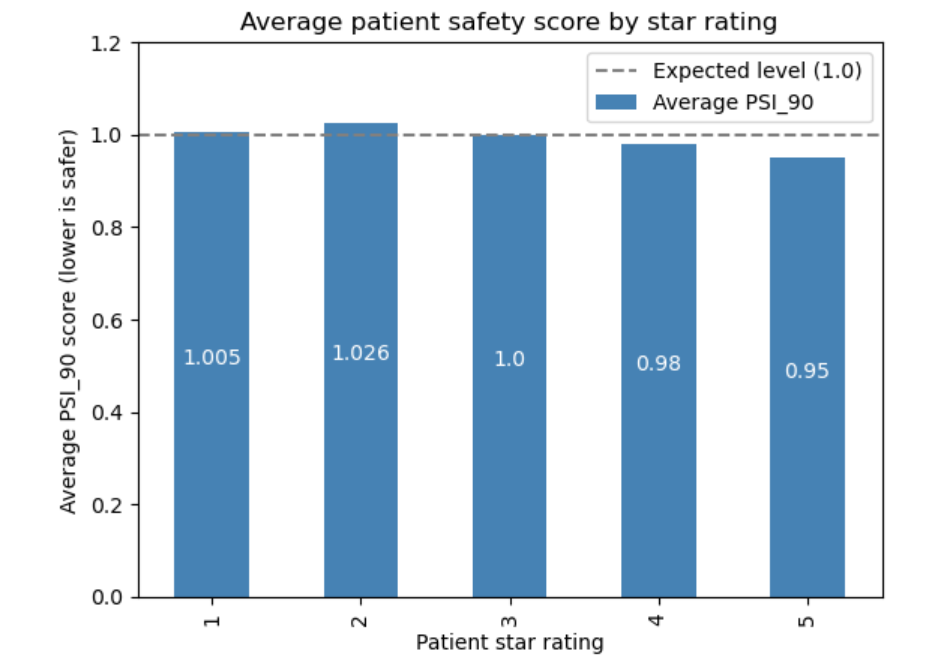
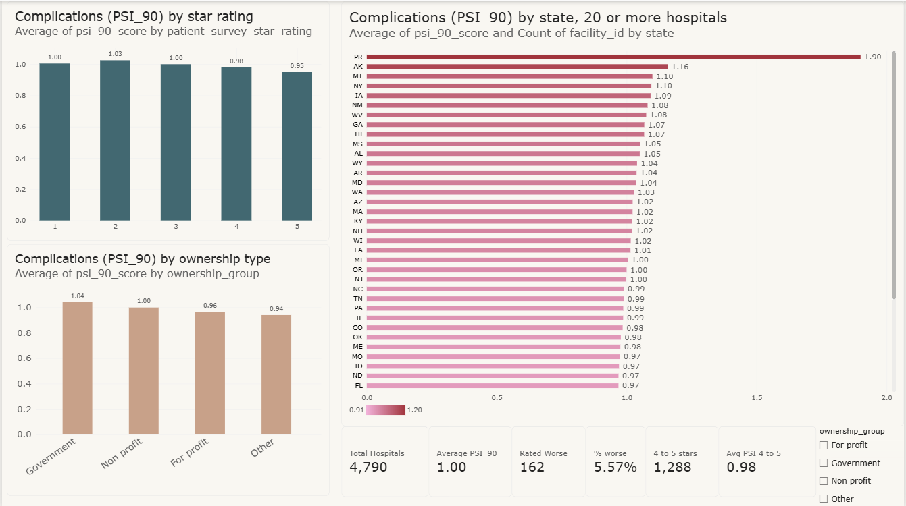
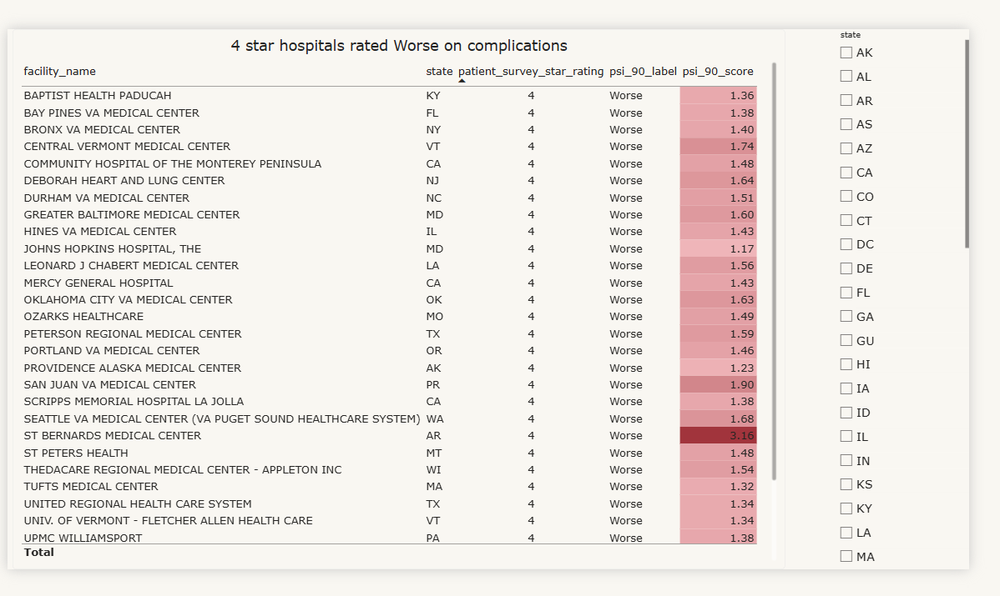
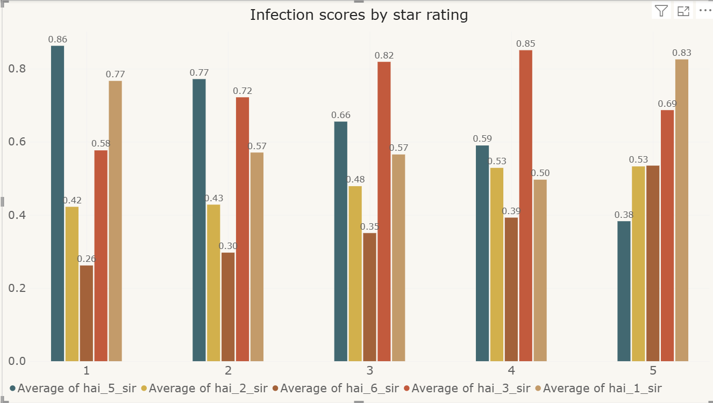

# Hospital Quality Scorecard

Do hospitals that patients rate highly actually have fewer infections and complications?

**In short:** Higher patient star ratings were linked to somewhat better safety, but not strongly. Hospitals rated 4 to 5 stars were rated Worse on complications about half as often as lower rated hospitals (3.5% against 6.9%). Even so, 32 hospitals with 4 stars were rated Worse, and infection results showed no consistent pattern. A high star rating is a modest sign of safety, not proof of it.

## 1. The question

Patients often choose hospitals by their star ratings. But the star rating comes from patient surveys about their experience, not from safety measures. This project asks: do hospitals that patients rate highly actually have fewer infections and complications? It uses real CMS hospital data to check whether a high rating means a safer hospital.

## 2. The data

The data is public CMS (Centers for Medicare and Medicaid Services) hospital data, downloaded from Kaggle (add the link to the exact dataset page here). I used four tables: general hospital information, patient survey ratings, infections, and complications and deaths. I loaded them into BigQuery, cleaned them, and joined them on facility ID. The general information table had 5,419 hospitals. The final table has 4,790, because 629 hospitals had no patient survey or safety data and could not be compared.

| Table | Rows | What it holds |
|---|---|---|
| General information | 5,419 | One row per hospital: name, state, type, ownership |
| Patient survey | 4,790 | One row per hospital: the patient survey star rating |
| Infections | 28,740 | 6 infection measures for each of 4,790 hospitals |
| Complications and deaths | 95,800 | 20 measures for each of 4,790 hospitals |
| Final table | 4,790 | One row per hospital after joining |

**Measures I used**

- **Complications:** PSI_90, a composite patient safety score. Lower is safer, and 1.0 is about what is expected nationally. I chose it because it combines many individual complication measures into one number and is reported for the most hospitals.
- **Infections:** five infection scores (standardized infection ratios, where lower is better and 1.0 is about expected): HAI_1, HAI_2, HAI_3, HAI_5 and HAI_6.
- **HAI_4:** kept in the final table, but left out of the dashboard chart because only 13% of hospitals have a value, so it could not support a fair comparison.
- **Other complication measures:** the other 19 are in the cleaned data, but I used PSI_90 for the analysis because it already summarizes complications. Eight of the 20 complication measures also have no Better or Worse label.

## 3. How I cleaned and joined it

- Reviewed all four tables and found many "Not Available" text values. I changed them to NULL in BigQuery so they would not break calculations and charts. I kept a status column to show the reason.
- Converted dates to a real date type and standardized the "compared to national" labels into Better, No Different and Worse.
- The infection and complication tables had one row per hospital per measure. I picked the reliable measures (PSI_90 for complications and five infection scores) and turned them into columns, so each hospital has one row.
- Grouped ownership into four groups: Non profit, For profit, Government and Other.
- Joined the four tables on facility ID into one final table with 4,790 hospitals, and checked there were no duplicates.

**From many rows to one row per hospital**

The infection and complication tables were in a long format: one row for each hospital and each measure. A hospital with 6 infection measures and 20 complication measures had 26 rows, so joining them directly to the other tables would have repeated every hospital many times and broken the counts and averages. I turned each measure into its own column, so every hospital has exactly one row.

Long format (before):

| facility_id | measure_id | score |
|---|---|---|
| 010001 | HAI_1_SIR | 0.80 |
| 010001 | HAI_2_SIR | 0.40 |

Wide format (after):

| facility_id | hai_1_sir | hai_2_sir |
|---|---|---|
| 010001 | 0.80 | 0.40 |

In SQL this is done with `max(case when measure_id = 'HAI_1_SIR' then score end)` for each measure, together with `group by facility_id`. The `case when` picks out the score for one measure, and `max` collapses the many rows of a hospital into one.

**Which measures I considered and why**

- **Infections:** I considered all six infection measures (HAI_1 to HAI_6) and kept all six in the final table. HAI_4 was left out of the dashboard chart because only 13% of hospitals have a value, so it could not support a fair comparison.
- **Complications:** I looked at all 20 complication and death measures. 12 of them are individual patient safety indicators with a Better, No Different or Worse label. The other 8 (the hospital wide readmission measure, six 30 day mortality measures and a hip and knee complication measure) have scores but no label. I chose PSI_90 because it is a composite of the individual safety indicators, so it gives one clear complication score per hospital, and it has both a score and a label.
- **Ownership:** the many raw ownership types were grouped into four groups (Non profit, For profit, Government and Other), so the groups are large enough to compare.

## 4. What I found

- **Complications:** Higher star ratings were linked to slightly lower PSI_90 scores (lower is safer). The averages were about 1.00, 1.03, 1.00, 0.98 and 0.95 for 1 to 5 stars. The pattern differs by ownership: for profit hospitals dropped steadily (0.99 to 0.92), while non profit hospitals did not. In the regression, star rating explained very little (R squared about 8%, with all inputs combined).
- **Infections:** There was no consistent pattern. Of the five infection scores, hai_5 fell as stars rose, hai_2 and hai_6 rose, and hai_1 and hai_3 moved up and down.
- **High rated but Worse:** 32 hospitals have 4 stars yet are rated Worse than the national rate on complications, and at least 11 are VA hospitals. No 5 star hospital was rated Worse. Overall, 5.57% of hospitals with a label are rated Worse.
- **Conclusion:** A high patient rating is a modest sign of safety. Average PSI_90 differs by only about 0.03 per star, but high rated hospitals were about half as likely to be rated Worse (3.5% against 6.9%). The models predict little overall, and state and ownership matter more than star rating. This is an association, not proof of cause.

**SQL analysis (BigQuery)**

I answered nine questions with SQL on the final table. Unless stated, the results use the 2,754 hospitals that have both a star rating and a PSI_90 score.

1. **How many hospitals have both a star rating and a PSI_90 score?** 2,754 of 4,790.
2. **Average PSI_90 by star rating:** 1.005 (1 star, 57 hospitals), 1.026 (2 stars, 533), 1.000 (3 stars, 1,251), 0.980 (4 stars, 823) and 0.950 (5 stars, 90).
3. **Better, No Different and Worse labels by star rating:** the number rated Worse was 3 of 57 at 1 star, 45 of 533 at 2 stars, 79 of 1,251 at 3 stars, 32 of 823 at 4 stars and 0 of 90 at 5 stars. Only 1 of the 90 five star hospitals was rated Better, and the other 89 were No Different.
4. **Average stars and PSI_90 by ownership group:**

| Ownership group | Hospitals | Average stars | Average PSI_90 |
|---|---|---|---|
| Other | 51 | 4.06 | 0.932 |
| Government | 433 | 3.37 | 1.042 |
| Non profit | 1,781 | 3.15 | 0.998 |
| For profit | 489 | 2.76 | 0.962 |

   For profit hospitals have the lowest average stars but the second best PSI_90, so stars and safety do not line up across ownership groups.

5. **Average stars and PSI_90 by hospital type:** the data has two types. Acute care hospitals (2,651 hospitals) average 3.10 stars and 0.995 PSI_90. Veterans Administration acute care hospitals (103) average 3.95 stars, the highest, but 1.060 PSI_90, the worst. This is the clearest case of a high rating without better safety.
6. **Average infection scores by star rating (lower is better):**

| Stars | Hospitals | HAI_1 | HAI_2 | HAI_3 | HAI_4 | HAI_5 | HAI_6 |
|---|---|---|---|---|---|---|---|
| 1 | 59 | 0.767 | 0.422 | 0.577 | 1.181 | 0.863 | 0.262 |
| 2 | 541 | 0.571 | 0.428 | 0.722 | 1.071 | 0.772 | 0.297 |
| 3 | 1,295 | 0.566 | 0.479 | 0.819 | 1.032 | 0.655 | 0.351 |
| 4 | 1,066 | 0.497 | 0.529 | 0.851 | 1.061 | 0.590 | 0.393 |
| 5 | 222 | 0.826 | 0.533 | 0.687 | 1.365 | 0.383 | 0.535 |

   Only HAI_5 falls steadily as stars rise. HAI_2 and HAI_6 rise, and the others move up and down.

7. **States with at least 20 hospitals (38 states):** the highest average stars are WI (3.83), UT (3.73), NE (3.63), LA (3.62) and KS (3.59). The lowest are FL (2.67), AZ (2.68), NJ (2.73), NY (2.74) and NV (2.75). UT combines high stars with a low PSI_90 of 0.914, while NY combines low stars with a high PSI_90 of 1.094, but the states overall do not show a clean pattern.
8. **Highly rated hospitals labelled Worse:** 32 hospitals, all with 4 stars (none with 5). 20 are non profit, 11 are government and 1 is in the Other group.
9. **High rated (4 to 5 stars) compared with lower rated (1 to 3 stars):** high rated hospitals number 913, average 0.977 PSI_90 and have 3.5% rated Worse. Lower rated hospitals number 1,841, average 1.008 and have 6.9% rated Worse. High rated hospitals were about half as likely to be rated Worse.

**Python models**

PSI_90 is a composite score, so one model covers complications as a whole. To avoid comparing unlike hospitals, I used control variables: ownership group, hospital type and state were held fixed in the same model, so the star rating effect is compared between similar hospitals. All models use the 2,754 hospitals that have both a star rating and a PSI_90 score.

- **Multiple linear regression:** PSI_90 explained by star rating, with ownership, hospital type and state as controls. Each extra star went with a PSI_90 that was 0.027 lower (coefficient -0.027). The p value was 0.00000006, and the 95 percent range for the true effect was -0.037 to -0.017. All four inputs together explain only 8.2% of the differences between hospitals (R squared 0.082).
- **Do the controls change the answer?** I added them one at a time. The star rating coefficient was -0.020 with no controls, -0.027 with ownership, -0.028 with ownership and type, and -0.027 with ownership, type and state. It stayed about the same, so the result is not explained by ownership, type or state.
- **Shuffle test:** I shuffled the star ratings 10,000 times to see how large a step chance alone produces. None of the 10,000 shuffles produced a step as large as the real one (-0.020), so the link is not chance.
- **Logistic regression:** the chance of being rated Worse, explained by star rating with ownership and hospital type as controls. The odds ratio was 0.568 per star (95 percent range 0.460 to 0.703, p value 0.0000002). Each extra star went with about 43% lower odds of being rated Worse. 159 of the 2,754 hospitals were rated Worse.
- **Random forest:** a model that predicts PSI_90 from the four inputs. It predicted little (test R squared 0.041). Permutation importance, which measures how much the prediction worsens when one input is shuffled, ranked state first (0.047), then ownership group (0.037), then star rating (0.022) and hospital type (0.008). Star rating matters, but state and ownership matter more.

Average PSI_90 by star rating, with the expected level of 1.0 shown as a dashed line:

## 5. Dashboard

Complications: star rating, ownership and state, with six summary cards and an ownership slicer.

The 32 hospitals rated 4 stars by patients but Worse than the national rate on complications, with a state slicer.

Infection scores by star rating.

**Power BI measures (DAX)**

I wrote six measures. Each one recalculates when a slicer changes, so the cards always match what is selected.

| Measure | Question it answers | Formula | Result |
|---|---|---|---|
| Hospitals | How many hospitals are in the data? | `FORMAT(COUNTROWS('hospital_final csv'), "#,0")` | 4,790 |
| Average PSI_90 | What is the average PSI_90 across all hospitals? | `AVERAGE('hospital_final csv'[psi_90_score])` | 1.00 |
| Rated Worse | How many hospitals are rated Worse on PSI_90? | `CALCULATE(COUNTROWS('hospital_final csv'), 'hospital_final csv'[psi_90_label] = "Worse")` | 162 |
| % Worse | What percent of hospitals with a label are rated Worse? | `DIVIDE([Rated Worse], CALCULATE(COUNTROWS('hospital_final csv'), 'hospital_final csv'[psi_90_label] <> ""))` | 5.57% |
| 4 to 5 stars | How many hospitals have 4 or 5 stars? | `CALCULATE(COUNTROWS('hospital_final csv'), 'hospital_final csv'[patient_survey_star_rating] >= 4)` | 1,288 |
| Avg PSI 4 to 5 | What is the average PSI_90 for 4 and 5 star hospitals? | `CALCULATE(AVERAGE('hospital_final csv'[psi_90_score]), 'hospital_final csv'[patient_survey_star_rating] >= 4)` | 0.98 |

What I learned from them:

- `CALCULATE` runs a calculation under a condition, like "count only the rows where the label is Worse". It is the DAX version of a SQL `where` clause.
- `DIVIDE` divides safely, without an error when the bottom number is zero.
- For % Worse the bottom number must count only hospitals that have a label. Blank labels are not Worse and not Better, so including them would understate the percent (3.38% instead of 5.57%). Testing for `<> ""` worked on this column, while `NOT(ISBLANK(...))` did not remove the blanks.
- `FORMAT` turns a number into text so a card shows 4,790 and not a shortened 5K. Because the result is text, I kept a separate numeric version of each count for calculations.

## 6. Limitations

- Only 2,754 of 4,790 hospitals (58%) had both a star rating and a PSI_90 score, so the complications results are based on those.
- Some groups are small: only 90 hospitals have 5 stars, only 51 are in the "Other" ownership group, and only 13% of hospitals have a `hai_4_sir` value, which is why it was left out of the dashboard. Averages for small groups are less reliable.
- This is an association, not proof of cause. High star ratings were weakly linked to lower complication scores, but other factors such as ownership, type and patient mix may play a role.
- Each measure covers one reporting period, and the periods differ between measures.
- Complications are represented by one composite score (PSI_90), so individual complication types are not compared.

## 7. Tools and files

- **SQL (BigQuery):** cleaning, joining and analysis queries in `project_queries.sql`
- **Python:** multiple linear regression with controls for ownership, hospital type and state, a logistic regression for "rated Worse", and a random forest with permutation importance, in `hospital_regression.ipynb`
- **Power BI:** the dashboard in `powerbi/hospital_quality_dashboard.pbix`, with six DAX measures (total hospitals, average PSI_90, hospitals rated Worse, percent Worse, hospitals with 4 to 5 stars, and average PSI_90 for those hospitals). Open it with Power BI Desktop, which is free and runs on Windows.
- **Data:** the final joined table is in `hospital_final.csv`.
